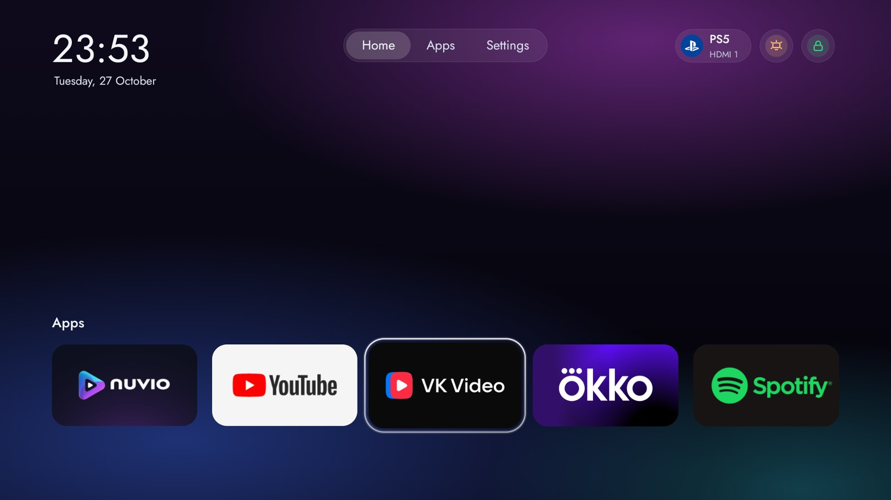
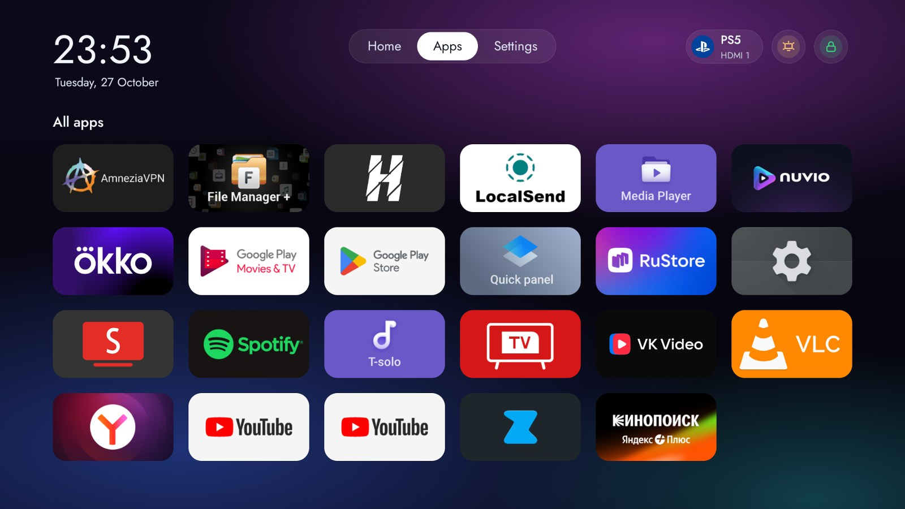
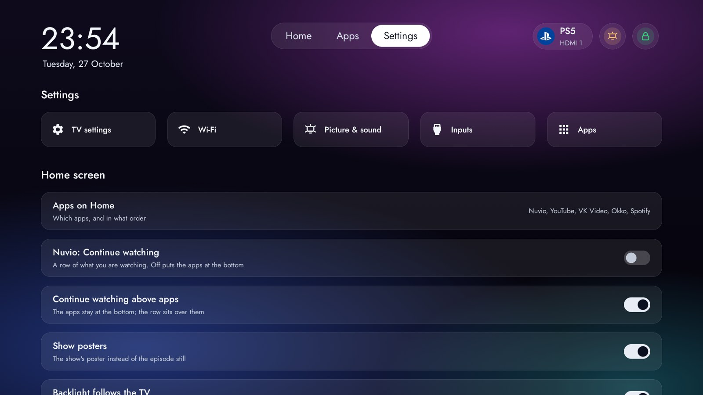
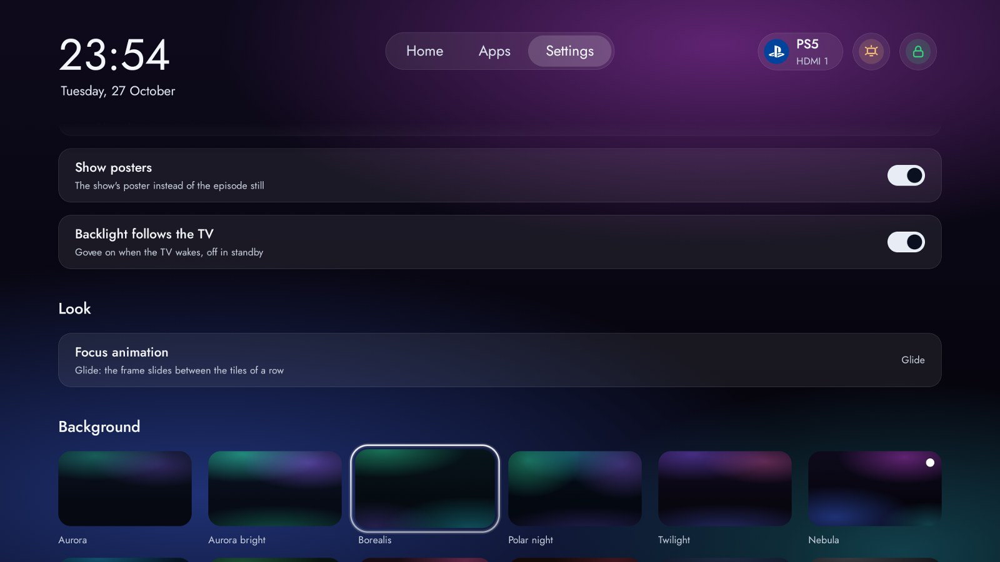
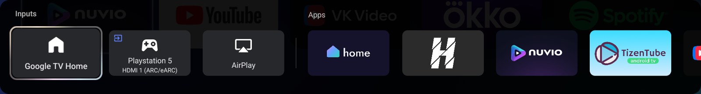
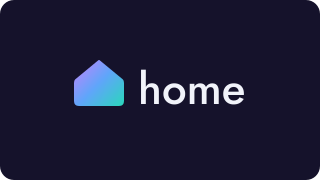
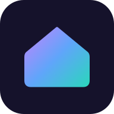

<p align="center">
  <picture>
    <source media="(prefers-color-scheme: dark)" srcset="docs/nebula/logo-dark.svg">
    
  </picture>
</p>

<p align="center">
  <b>A calm, ad-free home screen for Google TV.</b><br>
  Your apps, your PS5, your VPN and your backlight, one or two presses away.
</p>

<p align="center">
  
  
  
  
</p>

<p align="center">
  
</p>

## Why Nebula

Stock Google TV opens on rows of sponsored content, and its own app list hides the things you use daily.
Nebula replaces that with one quiet screen: a clock, a sky, and up to six apps you picked. Everything else
is a press away, and nothing on it is an advert.

It is built as a fork of [CleanYourTV](https://github.com/Gathin23/cleanyourtv), so it inherits that
project's safe install path: the TV's own Home stays in place underneath, and nothing is uninstalled.

## Highlights

<table>
  <tr>
    <td width="50%" valign="top">
      <br>
      <b>Home that stays out of the way.</b><br>
      Up to six apps of your choice at the bottom, a clock and the date, a soft sky behind them. No rows of
      recommendations, no autoplaying trailers.
    </td>
    <td width="50%" valign="top">
      <br>
      <b>Every app, one grid.</b><br>
      All installed apps as their own banners, with a menu on long press to add to Home, reorder, open App
      info or uninstall.
    </td>
  </tr>
  <tr>
    <td width="50%" valign="top">
      <br>
      <b>Settings you can read from the sofa.</b><br>
      Shortcuts to the TV's own settings, and switches for the home screen itself: which apps, Continue
      watching, posters, the backlight.
    </td>
    <td width="50%" valign="top">
      <br>
      <b>Your sky, your motion.</b><br>
      Twelve background skies, from Aurora to Graphite, and two focus styles: Lift, or Glide, where one
      glass ring slides between tiles on a Material 3 spring.
    </td>
  </tr>
</table>

## What it does

| | |
|---|---|
| **PS5 in one press** | A pill in the corner switches to the console's HDMI input over CEC. |
| **VPN at a glance** | A lock shows whether the VPN app is connected; press it to open the app. |
| **Continue watching** | Nuvio's Watch Next row, as episode stills or posters, below or above your apps. |
| **Govee backlight** | Toggle the lights from the bar, or let them follow the TV: on when it wakes, off in standby. |
| **Glass focus ring** | A translucent ring lit from above, so focus is clear without a hard white outline. |
| **Light on a 2 GB TV** | Plain Java views and bitmap skies: no video, no blur, no web views. |

## Pinned in the TV's own menu

Nebula ships its own icon and banner, so it can sit first in the TV's Input panel and open straight from
an HDMI input.

<p align="center">
  
</p>

<p align="center">
  
  &nbsp;&nbsp;
  
</p>

## Get started

You need JDK 17, the Android SDK (platform 34, build-tools 34.0.0) and a TV with network ADB turned on.
Read [README.cleanyourtv.md](README.cleanyourtv.md) and [AGENTS.md](AGENTS.md) first: they explain how
to keep the TV's Home, Wi-Fi and remote working while you change them.

1. Build and test the launcher:

   ```bash
   cd launcher
   ./gradlew --no-daemon testReleaseUnitTest lintRelease assembleRelease
   ```

2. Install it with the upstream script, which checks Home before and after:

   ```bash
   TV_HOST=<tv ip>:5555 launcher/build-and-install.sh
   ```

3. Turn the Nebula layout on in your theme's `config.json`, then push the theme (see
   [themes/README.md](themes/README.md)):

   ```json
   {
     "aurora_home": true,
     "vpn_app": "com.happproxy",
     "vpn_pill": true,
     "ps5_input": "com.tcl.tvinput/.TvPassThroughService/HW15",
     "watch_next_app": "com.nuvio.tv",
     "govee_api_key": "<your Govee API key>",
     "govee_sku": "H6099",
     "govee_auto": true
   }
   ```

Keep the Govee key in the theme on your own machine and on the TV only; never commit it. `ps5_input` is
your console's TV input id (`dumpsys tv_input` lists them).

On Google TV 14 the system keeps its stock launcher as Home, so Nebula leaves it enabled and opens itself
over it (`stock_home_redirect` with `"key_filter": false`). Held volume and the other remote buttons keep
working as they did.

## Tested on

TCL 55 C6K, Google TV 14 (`UTT2.250416.001`). Other Google TV and Android TV sets should work through the
same install path, but have not been tried.

## How it differs from CleanYourTV

CleanYourTV's launcher has no network access and no background work, on purpose, so it runs on 1 GB TVs.
Nebula needs both for the Govee backlight and Nuvio's posters (`INTERNET`, `WAKE_LOCK`,
`READ_TV_LISTINGS`), which is why it lives in its own repository rather than as a pull request. The rest
of CleanYourTV (debloat lists, tools, docs) is kept as it was.

## Credits

- [CleanYourTV](https://github.com/Gathin23/cleanyourtv) by Gathin: the launcher, tools and install
  path Nebula is built on.
- [Jost](https://github.com/indestructible-type/Jost) by Indestructible Type, under the SIL Open Font
  License (`launcher/third_party/jost/`).

## License

MIT, as upstream. The original copyright notice is kept in [LICENSE](LICENSE).
